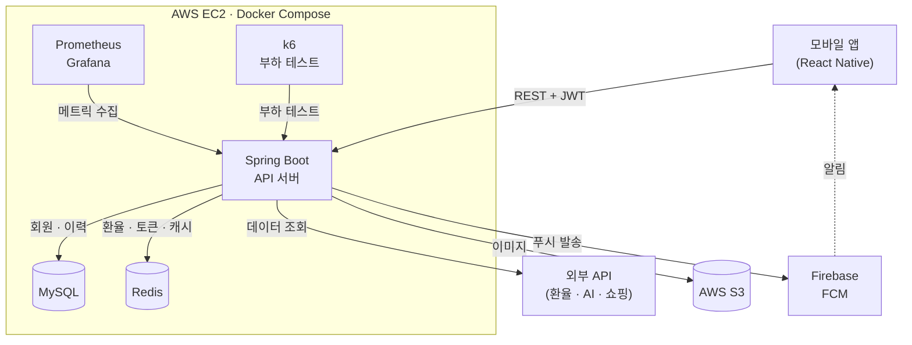
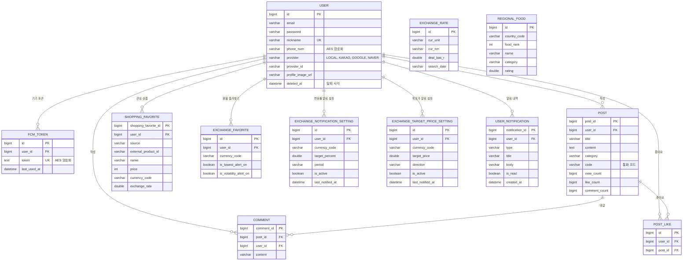
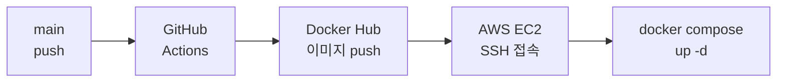

# PIGGY Backend

> 환율 기반 여행 유틸리티 서비스 **PIGGY** 의 백엔드 서버입니다.
> 실시간 환율 · 환전 타이밍 · 가격 OCR 환산 · 해외 쇼핑 가격 비교 · AI 챗봇 · 커뮤니티를 하나의 앱에서 제공합니다.

- Backend: https://github.com/piggy-project/piggy-backend
- Frontend: https://github.com/piggy-project/piggy-frontendApp

---

## 1. 프로젝트 개요

### 프로젝트명 & 한 줄 설명

| 항목 | 내용 |
| --- | --- |
| 프로젝트명 | PIGGY |
| 한 줄 설명 | 해외여행·직구 사용자를 위해 실시간 환율, 환전 타이밍, 가격 OCR 환산, 해외 쇼핑 가격 비교, AI 챗봇, 커뮤니티를 한 앱에서 제공하는 환율 기반 여행 유틸리티 서비스 |
| 플랫폼 | 모바일 앱(Android · iOS) + REST API 서버 |

### 개발 기간 및 인원

| 항목 | 내용 |
| --- | --- |
| 개발 기간 | 2026.02 ~ 2026.06 |
| 인원 | 총 2명 (프론트엔드 1명, 백엔드 1명) |
| 본인 역할 | 풀스택 (백엔드 + 프론트엔드) |

### 아키텍처 구조도



---

## 2. 사용 기술 스택

| 구분 | 기술 |
| --- | --- |
| Language | Java 21 |
| Backend | Spring Boot 3.2, Spring Security, JPA, OAuth2 Client, JWT, Swagger |
| Database / Cache | MySQL 8.0, Redis (Hash · Sorted Set · TTL 캐시) |
| 외부 연동 | 환율 API, Gemini 2.5 Flash, Google Cloud Vision, 네이버 쇼핑 · Rakuten · eBay · SerpAPI, Firebase FCM, AWS S3, SMTP 메일 |
| Infra / DevOps | Docker, Docker Compose, GitHub Actions(CI/CD), AWS EC2 |
| Monitoring | Prometheus, Grafana, k6 |
| Frontend | React Native, Expo Router, TypeScript, React Query, Axios |

---

## 3. 핵심 기능 및 담당 역할

### 핵심 기능

| 기능 | 설명 | 핵심 기술 |
| --- | --- | --- |
| 실시간 환율 | 주요 9개 통화의 현재가 · 전일 대비 · 당일 고저가 · 시간대별 추이 · 기간별 이력 제공. 최근 90일 환율 대비 현재 환율의 백분위로 환전 적기 안내 | 외부 환율 API, Redis Hash, `@Scheduled` |
| 환전 수수료 시뮬레이터 | 은행별(국민 · 신한 · 기업 · 토스 · 직접 입력) 수수료율과 우대율을 적용해 최종 수령 외화와 절약 금액 계산 | 정책 Enum, 실시간 환율 연동 |
| AI 여행지 추천 · 챗봇 | 해시태그별 여행지를 매시간 추천하고, 앱 사용법 · 여행 · 환율 질문에 답변하며 후속 질문 추천 | Gemini API, Redis 캐시 |
| 가격 OCR 스캔 | 가격표 사진에서 통화 기호와 금액을 인식해 실시간 환율로 원화 환산 | Google Cloud Vision, 정규식 파싱 |
| 해외 쇼핑 가격 비교 | 네이버(국내)와 통화별 해외 쇼핑 API(Rakuten · eBay · SerpAPI) 가격을 환율 환산해 비교, 검색어 랭킹 기반 인기 상품 제공 | 다중 외부 API, Redis Sorted Set |
| 환율 알림 (푸시) | 변동률 · 목표가 · 3개월 최저가 · 급등락 알림과 알림 내역 관리 | FCM, 스케줄러, Redis 쿨다운 |
| 커뮤니티 | 게시판(자유 · 환율 · 여행), 댓글, 좋아요, 핫 게시글, 이미지 업로드, 내 활동 조회 | Redis, AWS S3 |
| 회원 · 인증 | 이메일 가입(인증 메일), 카카오 · 구글 · 네이버 소셜 로그인, JWT 발급 · 재발급, 탈퇴 후 1개월 뒤 영구 삭제 | Spring Security, OAuth2, JWT |

---

## 4. ERD 및 시스템 아키텍처

### ERD



> `EXCHANGE_RATE`(일별 마감 환율 이력)와 `REGIONAL_FOOD`(국가별 추천 음식)는 사용자와 직접 연결되지 않는 기준 데이터입니다.
> 실시간 환율, Refresh Token, 각종 캐시와 쿨다운은 MySQL이 아닌 Redis에 저장합니다.

### 시스템 아키텍처

#### 계층 구조

도메인 단위로 패키지를 나누고, 각 도메인은 `controller → service → repository → entity / dto` 계층으로 구성했습니다.

```
com.piggy.piggybackend
├── auth          # OAuth2 로그인, 토큰 재발급
├── user          # 회원, 이메일 인증, FCM 토큰, 탈퇴 회원 정리
├── exchange      # 환율, 환전 타이밍, 시뮬레이터, 여행지 추천
├── notification  # 환율 알림 설정 · 발송, 알림 내역
├── shopping      # 가격 비교, OCR, 관심 상품, 현지 음식
├── community     # 게시글, 댓글, 좋아요
├── chatbot       # Gemini 기반 챗봇
└── global        # 보안 설정, 예외 처리, 공통 응답, Redis, S3, 유틸
```

#### Redis 사용처

| 용도 | 자료구조 / 키 | 비고 |
| --- | --- | --- |
| 실시간 환율 · 고저가 · 전일 마감가 | Hash | 매시 정각 갱신, 시간대별 스냅샷은 25시간 TTL |
| Refresh Token | String `RT:{email}` | TTL 14일, 재발급 시 교체 |
| 환전 타이밍 · 챗봇 · 쇼핑 검색 · 여행 추천 | String (TTL 캐시) | 1시간 · 60분 · 약 65분 |
| 검색어 랭킹 | Sorted Set | 인기 상품 선갱신에 사용 |
| 게시글 좋아요 · 핫 게시글 | Set · Sorted Set | 좋아요 수와 랭킹 관리 |
| 알림 쿨다운 | String + TTL | 최저가 24시간, 급등락 6시간 |

#### 스케줄러 타임라인

| 시각 | 작업 |
| --- | --- |
| 매시 0분 | 외부 환율 수집 → Redis 갱신, AI 여행지 추천 갱신 |
| 매시 1분 | 변동률 · 목표가 알림 검사 |
| 매시 5분 | 최저가 · 급등락 알림 검사 |
| 매일 00:00 | 당일 고저가 초기화, 통화별 인기 상품 캐시 갱신 |
| 매일 02:10 | 전일 마감 환율 DB 저장 |
| 매일 03:00 | 탈퇴 후 1개월 경과 회원 영구 삭제 |

#### 배포 파이프라인 (CI/CD)


